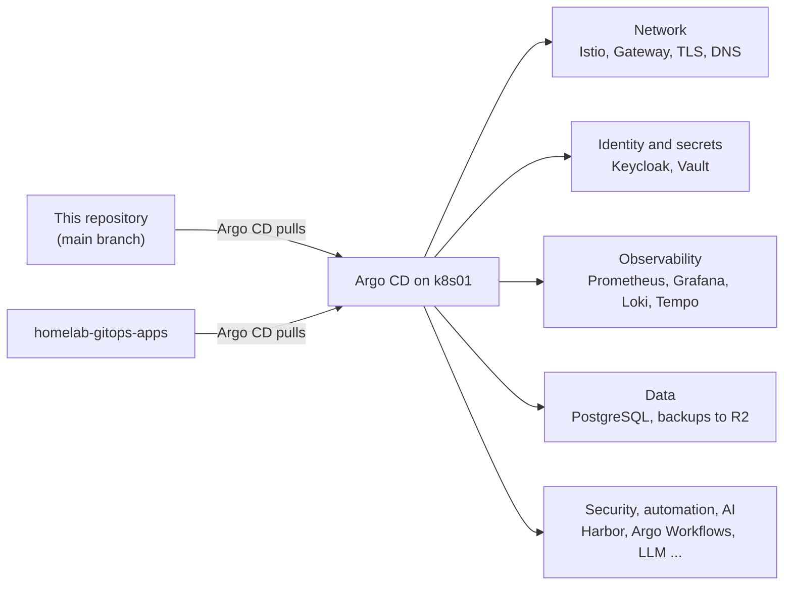

# homelab-gitops

The platform of a personal Kubernetes lab, described entirely in Git. **Argo CD** reads this repository and keeps
the cluster identical to it, including Argo CD itself. Every service is reached at `https://<name>.staffops.space`
from the home network, with a valid certificate and one Keycloak login.



## Start here

| I want to... | Read |
|--------------|------|
| understand the lab in five minutes | [docs/overview.md](docs/overview.md) |
| see how the pieces connect (diagrams) | [docs/architecture.md](docs/architecture.md) |
| know what is done and what is pending | [docs/status.md](docs/status.md) |
| change something | [docs/gitops-workflow.md](docs/gitops-workflow.md) and [AGENTS.md](AGENTS.md) |
| fix or operate something | [docs/runbooks/](docs/runbooks/README.md) |
| find any document | [docs/README.md](docs/README.md) |

## What is in this repository

```
bootstrap.sh                   first install: prerequisite CRDs + Argo CD   (diff | apply | status)
scripts/render-app.sh          render an app exactly like Argo CD does, with checks — before every push
scripts/vault.sh               Vault: init | unseal | configure | put | status
scripts/check-dashboard.py     run every query of a Grafana dashboard against Prometheus
helm-charts/environment.yaml   values shared by every app (domain, IPs, Vault paths, platform namespaces)
helm-charts/argo/              Argo CD + the list of platform apps (ApplicationSet platform)
helm-charts/<app>/             one directory per platform app (helmfile + one directory per release)
docs/                          overview, architecture, status, workflow, runbooks, decisions, dashboards
drafts/                        kept for later, not deployed
```

## Requirements

The kube context `k8s01` ([docs/runbooks/node.md](docs/runbooks/node.md)), `kubectl`, `helm` (+ `helm-diff`),
`helmfile`, `yq` and `jq`. After the first install, Argo CD manages itself: change it with a commit, never with
Helm. A first install from zero: [docs/runbooks/first-install.md](docs/runbooks/first-install.md).

## Related repositories

| Repository | Holds |
|------------|-------|
| `homelab-ansible` | the machine: Ubuntu, kubeadm, Calico, GPU driver, firewall |
| [homelab-gitops-apps](https://github.com/StaffOps/homelab-gitops-apps) | workload apps deployed on this platform |

## License

[MIT-0](LICENSE): use, copy, modify and redistribute freely, no attribution required, no warranty. Dashboards and
alert rules copied from upstream projects keep their own license: see [THIRD_PARTY.md](THIRD_PARTY.md).
