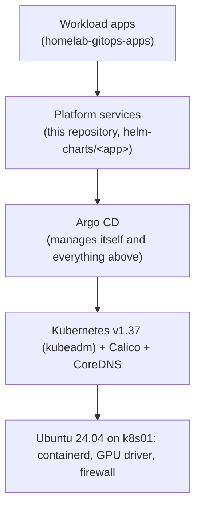
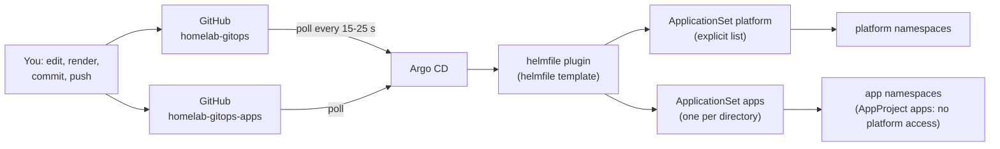
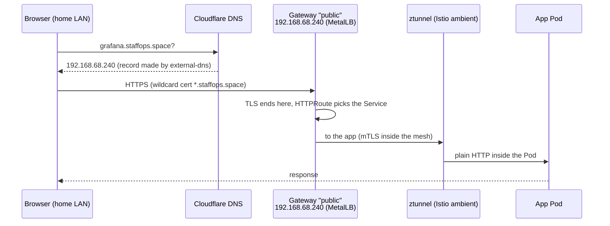
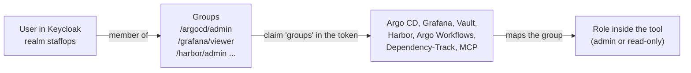
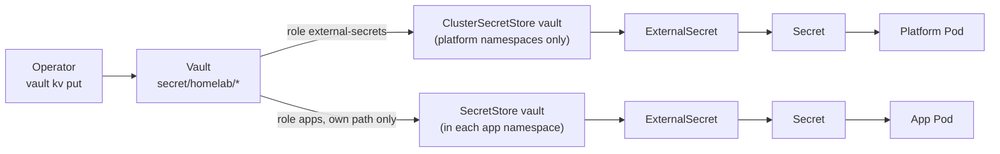
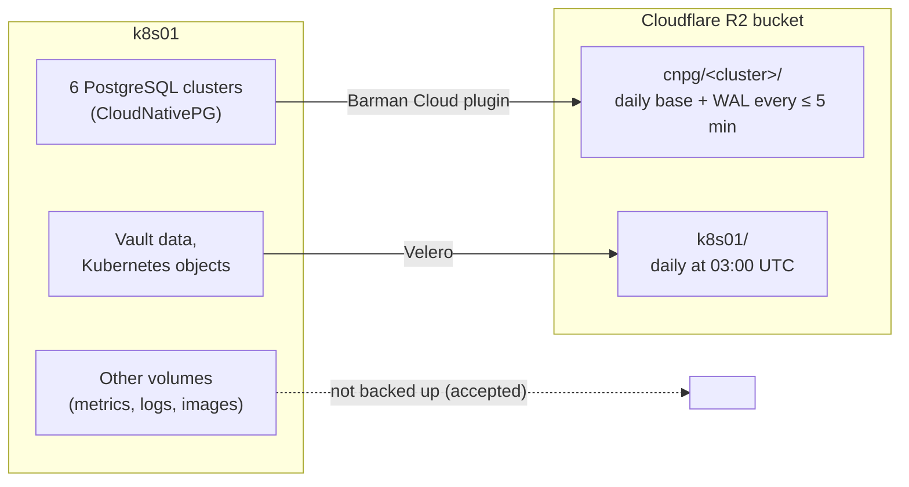
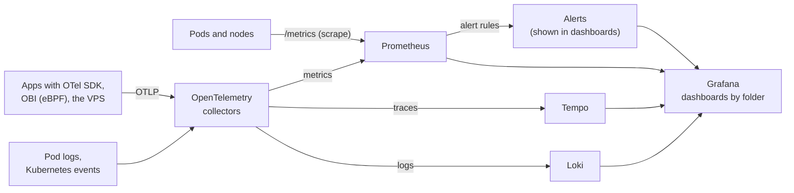
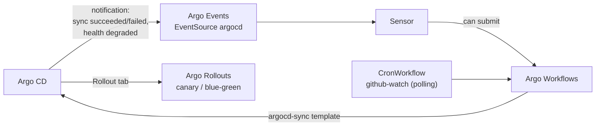

# Architecture

How the lab is built, one topic per section, each with a diagram. Start with [overview.md](overview.md) if you have
not read it. Words in *italics* are explained in the [glossary](glossary.md).

- [1. Layers](#1-layers)
- [2. Delivery: from Git to the cluster](#2-delivery-from-git-to-the-cluster)
- [3. Network: how a request arrives](#3-network-how-a-request-arrives)
- [4. Identity: one login for every tool](#4-identity-one-login-for-every-tool)
- [5. Secrets: from Vault to a Pod](#5-secrets-from-vault-to-a-pod)
- [6. Data and backups](#6-data-and-backups)
- [7. Observability and alerts](#7-observability-and-alerts)
- [8. Automation: Workflows, Events, Rollouts](#8-automation-workflows-events-rollouts)
- [9. Resilience on a single node](#9-resilience-on-a-single-node)
- [10. App catalog](#10-app-catalog)

## 1. Layers

| Layer | Built by | Changed by |
|-------|----------|------------|
| Host and Kubernetes | `homelab-ansible` (Ansible) | running the playbook |
| Argo CD | `./bootstrap.sh apply` once, then Argo CD itself | commit + push to `helm-charts/argo/` |
| Platform services | Argo CD, ApplicationSet `platform` | commit + push to `helm-charts/<app>/` |
| Workload apps | Argo CD, ApplicationSet `apps` | commit + push to `homelab-gitops-apps` |

The machine: one node `k8s01` (`192.168.68.104`, 8 CPU, 32 GB RAM, 240 GB SATA SSD, GeForce GT 740) on the home
LAN `192.168.68.0/24`. Kubernetes comes bare from kubeadm (ADR [0006](adr/0006-kubeadm-calico.md)): storage, load
balancer, gateway, metrics API and everything else are platform apps in this repository.

## 2. Delivery: from Git to the cluster

- Every app is a **helmfile** directory: one or more Helm charts plus a `*-raw` release for extra objects. Argo
  CD renders it with the helmfile plugin, exactly like `scripts/render-app.sh` does on your machine.
- **Platform** apps are listed one by one in `helm-charts/argo/argo-cd-raw/resources/applicationset-platform.yaml`
  (ADR [0002](adr/0002-self-managed-argo-cd-applicationset.md)).
- **Workload** apps live in [homelab-gitops-apps](https://github.com/StaffOps/homelab-gitops-apps): every directory
  becomes an app, with no change here (ADR [0007](adr/0007-separate-apps-repository.md)). Their *AppProject* keeps
  them out of platform namespaces and forbids cluster-wide objects.
- Every app syncs automatically with `prune` and `selfHeal`: manual changes in the cluster are reverted.
- Step-by-step: [gitops-workflow.md](gitops-workflow.md).

## 3. Network: how a request arrives

- **DNS**: external-dns writes `<app>.staffops.space → 192.168.68.240` in Cloudflare (not proxied). The address is
  private, so services are reachable only from the home network ([ADR 0004](adr/0004-cloudflare-dns.md)).
- **TLS**: cert-manager gets one wildcard certificate from Let's Encrypt with a DNS-01 challenge; no port is opened
  to the internet.
- **Gateway**: Istio implements the Kubernetes Gateway API ([ADR 0003](adr/0003-gateway-api-istio-ambient.md)). Each
  app adds an `HTTPRoute` to Gateway `public`. A second Gateway, `mcp` (`192.168.68.241`), serves only
  `mcp.staffops.space` and rejects requests without a valid Keycloak token.
- **Mesh**: every namespace except `kube-*`, `istio-system`, `calico-system` and `tigera-operator` runs in Istio
  *ambient mode* (Kyverno adds the label). Traffic between Pods is encrypted by *ztunnel*, with no sidecars. A
  NetworkPolicy in a mesh namespace must allow TCP 15008 (*HBONE*) and the probe source `169.254.7.127/32`.
- **Outbound**: Pods reach the internet directly (pulls, GitHub API, Let's Encrypt, R2).

## 4. Identity: one login for every tool

- One realm (`staffops`), one client per tool, and for each tool two groups: `/<tool>/admin` and
  `/<tool>/viewer`. Giving someone access means adding them to a group in Keycloak.
- Clients, groups and scopes are declared in git and applied by a Job after every sync of the `keycloak` app;
  users and memberships live in Keycloak's database.
- DefectDojo uses local accounts (its SSO is a paid feature since 3.0).
- Every tool keeps a local break-glass admin whose password is in Vault.
- Details and the table of roles: [runbooks/sso.md](runbooks/sso.md).

## 5. Secrets: from Vault to a Pod

- Vault is the only place with real secret values ([ADR 0005](adr/0005-vault-in-cluster.md)). Git holds only
  *ExternalSecrets* that say which key to copy.
- **Platform** namespaces read `secret/homelab/*` through the shared *ClusterSecretStore*. Its allow list is
  `platform.namespaces` in `helm-charts/environment.yaml`.
- **Workload apps** read only `secret/homelab/apps/<their namespace>/*` through their own *SecretStore* (Vault role
  `apps`, tested: another app's path is denied).
- Vault starts **sealed** after a restart. The CronJob `vault-autounseal` unseals it within 5 minutes. Existing
  Kubernetes Secrets keep working while it is sealed.
- Values that a chart would otherwise generate randomly come from Vault or from External Secrets generators created
  once, so Argo CD renders are always identical.
- Commands and the list of keys: [runbooks/vault.md](runbooks/vault.md).

## 6. Data and backups

- **Storage**: `local-path` volumes on the node's SSD. One node means no replication: a dead disk loses what is
  not in R2.
- **Databases**: CloudNativePG runs `keycloak-db`, `dtrack-db`, `harbor-db`, `workflows-db`, `defectdojo-db` and
  `grafana-db`. Each one streams its *WAL* to R2 and takes a daily base backup, so it can be restored to any point
  in the last 30 days.
- **Velero** backs up the namespaces `vault`, `keycloak` and `dependency-track` (objects and volumes, without the
  database files).
- **Not backed up, on purpose**: metrics, logs, traces, Harbor images, DefectDojo uploads.
- Restore and full rebuild: [runbooks/backup.md](runbooks/backup.md), [runbooks/disaster-recovery.md](runbooks/disaster-recovery.md).

## 7. Observability and alerts

- **Metrics**: Prometheus scrapes every ServiceMonitor and PodMonitor in every namespace.
- **Logs and traces**: OpenTelemetry collectors gather Pod logs, Kubernetes events and OTLP from apps. OBI adds
  eBPF traces for namespaces matching `staffops*`. The VPS sends OTLP to `https://otel.staffops.space` with a
  token.
- **Dashboards**: every service has a dashboard with a "How to read this dashboard" panel, an "Active alerts for
  this service" table and a description on every panel. Folders: Kubernetes, Networking & Ingress, Security &
  Identity, Observability, GitOps & Platform, Databases, AI & GPU. Catalog: [dashboards/README.md](dashboards/README.md).
- **Alerts**: rules come from upstream mixins and project docs, each with its source. Alertmanager has no receiver
  **on purpose** (no notifications while the lab is being built). See them in Grafana → Observability → **Alerts
  overview**, or at the top of each service dashboard.

## 8. Automation: Workflows, Events, Rollouts

- **Argo Workflows** runs pipelines and scheduled jobs. Templates: `argocd-sync` syncs an app and waits for it to
  be healthy; `github-watch` polls a GitHub repository for a new release or tag (GitHub cannot reach the lab, so
  there are no webhooks).
- **Argo Events** receives Argo CD notifications and can start workflows from them.
- **Argo Rollouts** does canary and blue-green releases with Gateway API traffic splitting and Prometheus analysis.
  It is operated from the Argo CD UI (its own dashboard has no login).
- Details: [runbooks/argo-workflows.md](runbooks/argo-workflows.md).

## 9. Resilience on a single node

One node cannot survive its own failure. The goal is narrower: a crash, restart or rollout of **one Pod** must not
stop the components everything depends on.

| Measure | Where |
|---------|-------|
| 2 replicas (rollouts keep both up: `maxUnavailable` rounds to 0) | CoreDNS, istiod, both Gateways, Kyverno admission, metrics-server, cert-manager and External Secrets webhooks, CloudNativePG operator |
| No PodDisruptionBudgets | they would block `kubectl drain` on one node (Kyverno's forced PDB is set to `maxUnavailable: 2`) |
| ztunnel without limits | throttling or killing it would cut the network of every mesh Pod |
| Vault auto-unseal | CronJob every 5 minutes after a restart |
| Backups to R2 | databases (point in time), Vault, Kubernetes objects |

Known limits: one SATA SSD shared by everything (fast enough for etcd, checked with `fio`), Vault in file mode
(no HA until there are more nodes), and the host itself.

## 10. App catalog

| Group | App (`helm-charts/…`) | Namespace | What it does |
|-------|-----------------------|-----------|--------------|
| Delivery | `argo` | argo | Argo CD (manages itself), ApplicationSets `platform` and `apps` |
| | `argo-rollouts` | argo-rollouts | progressive delivery, Gateway API plugin, analysis templates |
| | `argo-workflows` | argo-workflows | workflows, CronWorkflows, archive in `workflows-db`, logs in R2 |
| | `argo-events` | argo-events | EventBus (NATS JetStream), EventSource `argocd`, Sensors |
| | `keda` | keda | event-driven autoscaling |
| Cluster basics | `local-path-provisioner` | local-path-storage | StorageClass `local-path` (node SSD) |
| | `metrics-server` | kube-system | metrics API (`kubectl top`, HPA) |
| | `kubelet-csr-approver` | kube-system | approves kubelet certificate renewals |
| | `kyverno` | kyverno | policies: Pod Security baseline (audit), zone label, ambient label |
| | `nvidia-device-plugin` | nvidia-device-plugin | exposes the GPU (`nvidia.com/gpu: 1`) |
| Network | `metallb` | metallb-system | LoadBalancer IPs `192.168.68.240-245` |
| | `istio` | istio-system | Istio ambient (istiod, CNI, ztunnel) |
| | `gateway` | gateway | Gateways `public` and `mcp`, wildcard certificate |
| | `cert-manager` | cert-manager | Let's Encrypt certificates (DNS-01) |
| | `external-dns` | external-dns | Cloudflare records for HTTPRoutes |
| Identity and secrets | `vault` | vault | secret store |
| | `external-secrets` | external-secrets | copies secrets from Vault |
| | `keycloak` | keycloak | single sign-on, realm `staffops` |
| Observability | `monitoring` | monitoring | Prometheus, Grafana, Alertmanager, Loki, Tempo, dashboards, alerts |
| | `opentelemetry` | opentelemetry | OTel operator, collectors, OBI |
| Data | `cloudnative-pg` | cnpg-system | PostgreSQL operator + Barman Cloud plugin |
| | `velero` | velero | Kubernetes and volume backups to R2 |
| Security | `harbor` | harbor | image and Helm chart registry with Trivy |
| | `dependency-track` | dependency-track | SBOM analysis |
| | `defectdojo` | defectdojo | vulnerability management |
| AI | `llm` | llm | llama.cpp on the GPU, OpenAI-compatible API |
| | `mcp-servers` | mcp-servers | read-only MCP servers for AI agents |

Versions are pinned in each app's `helmfile.yaml.gotmpl`; the current list is in [status.md](status.md).
