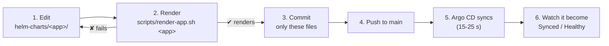

# How to change the lab

Every change goes through Git. Argo CD applies `main` automatically and reverts anything changed by hand in the
cluster. A change is safe when it was **rendered locally before the push**.



## Change an existing app

1. Edit `helm-charts/<app>/…`, or `helm-charts/environment.yaml` for values shared by every app (domain, IPs, Vault
   paths, platform namespaces).
2. Render it. It must end with `✔ helm-charts/<app> renders`. Read the objects and images it lists:
   ```bash
   scripts/render-app.sh <app>
   ```
3. Commit only the files of the change, with a [Conventional Commits](https://www.conventionalcommits.org/) message,
   and push to `main`.
4. Watch it in `https://argocd.staffops.space`, or:
   ```bash
   kubectl --context k8s01 -n argo get application <app> -w
   ```

## Add a platform app

1. Create `helm-charts/<app>/helmfile.yaml.gotmpl` (copy a small app such as `external-dns`). Rules in
   [AGENTS.md](../AGENTS.md): pinned versions, 4-space YAML, an `<app>-raw` release for extra objects.
2. Expose it with an HTTPRoute to Gateway `public` (`sectionName: https`, host `<app>.staffops.space`), take secrets
   through ExternalSecrets, enable its ServiceMonitor.
3. Write its secrets in Vault **before** the first sync ([runbooks/vault.md](runbooks/vault.md)).
4. Add its namespace to `platform.namespaces` in `helm-charts/environment.yaml`, and an element
   `{appName, path, namespace}` to `helm-charts/argo/argo-cd-raw/resources/applicationset-platform.yaml`.
5. Render the app and `argo`, commit, push.

## Add a workload app

Workload apps go to the other repository, [homelab-gitops-apps](https://github.com/StaffOps/homelab-gitops-apps):
copy `_template/` to `<app>/`, render with its own `scripts/render-app.sh`, push. Nothing changes here.

## Remove an app

Remove its element from the ApplicationSet and push. The Application disappears but its resources stay
(`preserveResourcesOnDeletion`); delete them on purpose: [runbooks/argocd.md](runbooks/argocd.md).

## Upgrade a chart

Bump `version` in the app's helmfile, read the chart's changelog, render, push.

- Istio's four charts move together (`istio.version`).
- After a kube-prometheus-stack upgrade, align `PROM_CRDS_CHART_VERSION` in `bootstrap.sh` and run
  `./bootstrap.sh apply` for the CRDs.

## Change Argo CD itself

Same flow under `helm-charts/argo/`, rendered with `scripts/render-app.sh argo`.

> **Warning:** never run `helm` or `helmfile apply` for the `argo-cd` release on the running cluster: Argo CD owns
> those objects. If a change breaks Argo CD so badly that it cannot sync the fix, see
> [runbooks/argocd.md](runbooks/argocd.md).
