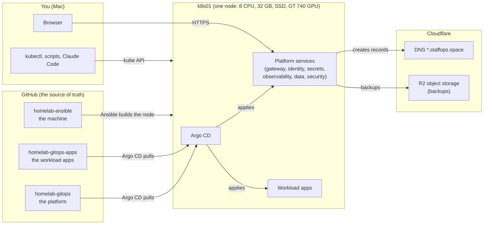

# The lab in five minutes

A personal Kubernetes platform on **one machine at home** (`k8s01`). Everything it runs is described in Git and
applied automatically by **Argo CD**. Services are reached at `https://<name>.staffops.space` from the home
network, with real certificates and a single login (**Keycloak**).

## The big picture

## Five ideas that explain everything

1. **Git is the truth.** What is on `main` is what runs. Argo CD checks the repositories every ~20 seconds and
   corrects any drift (`selfHeal`). You change the lab with a commit, not with `kubectl apply`.
2. **Three repositories, three jobs.** `homelab-ansible` installs the machine and Kubernetes. `homelab-gitops`
   (this one) holds the platform. `homelab-gitops-apps` holds the apps built on top of it.
3. **One door in.** Every web service sits behind one Istio Gateway at `192.168.68.240`. TLS, DNS and login are
   solved once, at that door, not in each app.
4. **Secrets live only in Vault.** Git never contains a password. External Secrets copies what each app needs
   from Vault into Kubernetes.
5. **You see everything in Grafana.** Every service has a dashboard and alert rules. Alerts are shown in the
   dashboards (there is no paging on purpose).

## What runs here

| Group | Services | Why it is here |
|-------|----------|----------------|
| Delivery | Argo CD, Argo Rollouts, Argo Workflows, Argo Events | deploy from Git, progressive rollouts, automation |
| Network | Istio (ambient), Gateway API, MetalLB, external-dns, cert-manager, Calico | reach services safely by name with TLS |
| Identity and secrets | Keycloak, Vault, External Secrets, Kyverno | one login, no secrets in Git, policies |
| Observability | Prometheus, Grafana, Loki, Tempo, OpenTelemetry, Alertmanager | metrics, logs, traces, dashboards, alerts |
| Data | CloudNativePG (PostgreSQL), local-path storage, Velero | databases and backups to R2 |
| Security | Harbor, Dependency-Track, DefectDojo | images, SBOMs, vulnerability management |
| AI | llama.cpp on the GPU, MCP servers | a local LLM and tools for AI agents |

## Where to click

| Service | URL | Login |
|---------|-----|-------|
| Argo CD | https://argocd.staffops.space | Keycloak |
| Grafana | https://grafana.staffops.space | Keycloak |
| Vault | https://vault.staffops.space | Keycloak (OIDC) |
| Keycloak | https://keycloak.staffops.space | Keycloak admin |
| Argo Workflows | https://argo-workflows.staffops.space | Keycloak |
| Harbor | https://harbor.staffops.space | Keycloak |
| Dependency-Track | https://dependency-track.staffops.space | Keycloak |
| DefectDojo | https://defectdojo.staffops.space | local account |
| Prometheus | https://prometheus.staffops.space | — |
| Alertmanager | https://alertmanager.staffops.space | — |
| LLM (OpenAI API) | https://llm.staffops.space | API key |
| MCP servers | https://mcp.staffops.space/&lt;name&gt; | Keycloak token |

All names resolve to private addresses: they work only from the home network.

## Next

- How the pieces connect, with diagrams: [architecture.md](architecture.md)
- What is done and what is pending: [status.md](status.md)
- How to change something: [gitops-workflow.md](gitops-workflow.md)
- Words you may not know: [glossary.md](glossary.md)
