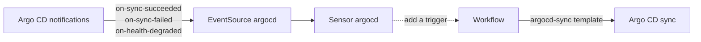

# Argo Workflows, Events and Rollouts

## What this is about

The three Argo tools besides Argo CD: Argo Workflows runs jobs, Argo Events reacts to events, and Argo Rollouts does
progressive delivery. This runbook covers access, how they connect to Argo CD, watching a GitHub repository and their
secrets.

## When to use it

- Someone needs access to the Argo Workflows UI.
- You want a workflow to run after an Argo CD sync, or to sync an app from a workflow.
- You want to react to a new release or tag of a GitHub repository.
- The `argocd-token` of Argo Workflows must be created or regenerated.

## Before you start

- Kube context `k8s01`.
- Membership in `/argo-workflows/admin` in Keycloak ([sso.md](sso.md#give-a-person-access)).
- For the token: an Argo CD admin login and the `argocd` CLI, and `vault login` with the root token or an OIDC admin.

## The three tools

| Tool | Namespace | Where | What it does here |
|------|-----------|-------|-------------------|
| Argo Workflows | `argo-workflows` | https://argo-workflows.staffops.space (Keycloak) | runs workflows and CronWorkflows; archive in `workflows-db` (CloudNativePG, 30 days), logs and artifacts in R2 (own bucket `staffops-k8s-argo-workflows`, `argo-workflows/` prefix, token in Vault `argo-workflows-r2`) |
| Argo Events | `argo-events` | — | EventBus `default` (NATS JetStream, 1 server); EventSource `argocd` receives Argo CD notifications; Sensors start workflows |
| Argo Rollouts | `argo-rollouts` | Argo CD UI (Rollout tab) | canary / blue-green for `Rollout` objects, Gateway API traffic split, analysis with the ClusterAnalysisTemplates `success-rate`, `p95-latency`, `pod-restarts` |

### Access

| Keycloak group | Argo Workflows role |
|----------------|---------------------|
| `/argo-workflows/admin` | ClusterRole `argo-workflows-admin` |
| `/argo-workflows/viewer` | ClusterRole `argo-workflows-view` |
| anyone else | no access |

The mapping uses the ServiceAccounts `sso-admin` / `sso-viewer` with the annotation `workflows.argoproj.io/rbac-rule`.
Argo Rollouts has no UI of its own (its dashboard has no authentication): open a Rollout in Argo CD. Promote and
abort follow Argo CD RBAC.

### Integration with Argo CD



- **Argo CD → Argo Events**: the notifications controller posts `on-sync-succeeded`, `on-sync-failed` and
  `on-health-degraded` of every Application to `http://argocd-eventsource-svc.argo-events.svc:12000/argocd`
  (`{app, project, revision, sync, health, phase}`). The Sensor `argocd` only logs them today; add a trigger to run a
  workflow.
- **Argo Workflows → Argo CD**: the ClusterWorkflowTemplate `argocd-sync` (template `sync`, parameter `app`) syncs an
  Application and waits for it, as the Argo CD local account `argo-workflows` (only `applications get` and `sync`).
- **Workflow as a sync hook**: a `Workflow` with `argocd.argoproj.io/hook: PostSync` in an app's manifests runs after
  the sync. Argo CD waits for it and shows its result.
- **UI**: Workflow, CronWorkflow and WorkflowTemplate objects in Argo CD link to their page in Argo Workflows.
  Rollouts get the rollout-extension tab.

## Procedures

### Watch a GitHub repository

GitHub cannot reach the lab, so there are no webhooks: a CronWorkflow polls instead.

1. Add a CronWorkflow like this one to an app's manifests:

    ```yaml
    apiVersion: argoproj.io/v1alpha1
    kind: CronWorkflow
    metadata:
        name: watch-my-repo
        namespace: argo-workflows
    spec:
        schedules: ["*/5 * * * *"]
        concurrencyPolicy: Forbid
        workflowSpec:
            workflowTemplateRef:
                name: github-watch
                clusterScope: true
            arguments:
                parameters:
                    - name: repo
                      value: owner/name
                    - name: what
                      value: release # or tag
                    - name: on-change
                      value: my-release-pipeline # WorkflowTemplate in argo-workflows, gets parameters repo + version
    ```

2. Render and push ([gitops-workflow.md](../gitops-workflow.md)).

Expect: the first run only records the current value (ConfigMap `github-watch-<owner>-<name>-<what>`). Later runs
submit `on-change` when the value changes.

> **Note:** the anonymous GitHub API allows 60 requests per hour per IP. For more, or for private repositories, run
> `scripts/vault.sh put github token` and add an ExternalSecret `github-token` (key `token`) in `argo-workflows`; the
> template uses it when present. Images pushed to Harbor can notify directly (Harbor webhook → an Argo Events
> `webhook` EventSource), with no polling.

### Secrets

Vault `homelab/argo-workflows` holds two keys:

| Key | What it is |
|-----|------------|
| `oidc-client-secret` | secret of the Keycloak client `argo-workflows`; the realm import reads it too |
| `argocd-token` | token of the Argo CD account `argo-workflows` |

Create the token after Argo CD has the account, then add it without touching the other key:

```bash
argocd account generate-token --account argo-workflows   # as an Argo CD admin
vault kv patch secret/homelab/argo-workflows argocd-token=<token>
```

Then [force a refresh](vault.md#force-a-refresh) of the ExternalSecret `argo-workflows/argocd-token`.

Expect: a workflow using the `argocd-sync` template syncs its app.

> **Note:** `scripts/vault.sh put` would replace the whole secret and drop `oidc-client-secret`: use `vault kv patch`
> for a single key.

## Check

```bash
kubectl --context k8s01 -n argo-workflows get pods
kubectl --context k8s01 -n argo-events get eventbus,eventsources,sensors
kubectl --context k8s01 -n argo-workflows get cronworkflows
```

## If it goes wrong

- Login refused: the user is not in `/argo-workflows/admin` or `/argo-workflows/viewer` ([sso.md](sso.md)).
- `argocd-sync` fails with `401`/`403`: the token expired or Argo CD was reinstalled (new signing key). Generate it
  again as above.
- Archive missing: check `workflows-db` ([backup.md](backup.md#check-the-backups)).
