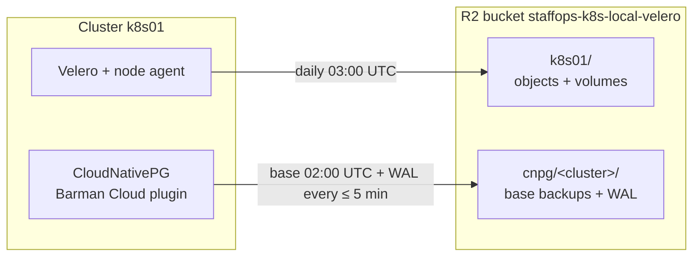

# Backup (Velero and CloudNativePG to Cloudflare R2)

## What this is about

Two tools back up the lab to one Cloudflare [R2](../glossary.md) bucket, with no overlap: Velero copies Kubernetes
objects and volumes, and the CloudNativePG Barman Cloud plugin copies the PostgreSQL databases. This runbook covers
the setup, the daily checks, manual backups and restoring one namespace or one database.

## When to use it

- Alerts `VeleroBackupFailed`, `VeleroBackupStale`, `CNPGBackupTooOld`, `CNPGBackupFailed` or `CNPGWalArchivingFailing`.
- Before a risky change, to take a manual backup.
- To restore one namespace or one database (for example after a bad migration).
- First install: create the bucket and its token.

For a full rebuild of the node, use [disaster-recovery.md](disaster-recovery.md) instead.

## Before you start

- Kube context `k8s01`.
- The `velero` CLI and the `kubectl cnpg` plugin on your machine.
- For setup: access to the Cloudflare dashboard and to Vault (`scripts/vault.sh`, see [vault.md](vault.md)).

## What is backed up, and where



| What | Tool | Prefix in the bucket | Schedule / retention |
|------|------|----------------------|----------------------|
| Kubernetes objects of `backup.namespaces` (`vault`, `keycloak`, `dependency-track`): Cluster CRs, generated Secrets such as `keycloak-db-app`, PVCs; and every volume of those namespaces **except** PostgreSQL data (Vault storage, Dependency-Track data) | Velero (Schedule `velero-daily`) | `k8s01/` | 03:00 UTC, 30 days (`backup.ttl`) |
| PostgreSQL `keycloak-db`, `dtrack-db`, `harbor-db`, `workflows-db`, `defectdojo-db`, `backstage-db`, `grafana-db`: base backup + continuous [WAL](../glossary.md) (point-in-time recovery) | CloudNativePG [Barman Cloud](../glossary.md) plugin | `cnpg/<cluster>/` | base 02:00 UTC + WAL every ≤ 5 min, 30 days |

Not backed up, on purpose:

- everything Argo CD recreates from git;
- metrics, logs, traces and Alertmanager state (`monitoring`): not worth the cost;
- Harbor's image storage: images can be pushed again. Harbor's database (projects, users, policies) is backed up.

> **Note:** Velero skips the PostgreSQL `pgdata` volumes (Cluster `inheritedMetadata` annotation
> `backup.velero.io/backup-volumes-excludes: pgdata`): a file copy of a running database is not consistent. Restore
> databases from the CloudNativePG backups.

> **Note:** Velero copies volumes with its node agent (Kopia file-system backup), because `local-path` has no
> snapshots. Vault data is encrypted by Vault: a restore is useless without the unseal key.

Configuration lives in `helm-charts/environment.yaml` under `backup` (bucket, TTL, namespaces) and `backup.postgres`
(prefix, retention, schedule). Per database there is an [ObjectStore](../glossary.md) `<cluster>-r2`, an ExternalSecret
`<cluster>-r2` (the R2 token from Vault `homelab/velero`) and a `ScheduledBackup` `<cluster>-daily` in the app's
`-raw` release. The plugin release is `plugin-barman-cloud` in `helm-charts/cloudnative-pg`.

## Procedures

### One-time setup: R2 bucket and token

1. Cloudflare → R2 → Create bucket `staffops-k8s-local-velero` (location automatic). R2 must be enabled on the account.
2. R2 → Manage API tokens → Create API token: permission **Object Read & Write**, specific bucket
   `staffops-k8s-local-velero`, no expiry. Note the **Access Key ID** and **Secret Access Key** (shown once). Keep a
   copy in the password manager: [disaster recovery](disaster-recovery.md) needs it.
3. Store the token in Vault (hidden prompts):

    ```bash
    scripts/vault.sh put velero access-key-id secret-access-key endpoint
    ```

    | Key | Value |
    |-----|-------|
    | `access-key-id` | the 32-character Access Key ID |
    | `secret-access-key` | the 64-character Secret Access Key |
    | `endpoint` | the bucket's S3 API URL without the bucket path: `https://<account-id>.r2.cloudflarestorage.com` |

    The endpoint stays out of git because it contains the account id.

4. Check the storage location:

    ```bash
    kubectl --context k8s01 -n velero get backupstoragelocation default
    ```

    Expect: `Available`.

### Check the backups

```bash
velero --kubecontext k8s01 backup get
kubectl --context k8s01 get scheduledbackups.postgresql.cnpg.io,backups.postgresql.cnpg.io -A
```

Expect: a recent `Completed` Velero backup, and a recent `completed` CloudNativePG backup per cluster.

For one database (here `keycloak-db`):

```bash
kubectl --context k8s01 -n keycloak get objectstore keycloak-db-r2 -o jsonpath='{.status}'        # first/last recoverability point
kubectl --context k8s01 -n keycloak get cluster keycloak-db -o jsonpath='{.status.conditions}'    # ContinuousArchiving=True
```

Dashboards: Databases → CloudNativePG, and the Velero dashboard.

### Take a manual backup

Velero, from the daily schedule:

```bash
velero --kubecontext k8s01 backup create manual-$(date +%Y%m%d%H%M) --from-schedule velero-daily
velero --kubecontext k8s01 backup describe <name> --details
```

Expect: phase `Completed`.

CloudNativePG, an on-demand base backup (change the namespace and cluster name):

```bash
kubectl --context k8s01 -n keycloak create -f - <<'YAML'
apiVersion: postgresql.cnpg.io/v1
kind: Backup
metadata:
    generateName: keycloak-db-manual-
spec:
    cluster:
        name: keycloak-db
    method: plugin
    pluginConfiguration:
        name: barman-cloud.cloudnative-pg.io
YAML
```

Expect: `kubectl --context k8s01 -n keycloak get backups.postgresql.cnpg.io` shows it `completed`.

### Restore a namespace with Velero

Restore into an empty namespace: delete it first, or restore under another name with
`--namespace-mappings old:new`.

> **Warning:** deleting a namespace deletes its PVCs and data. Make sure the backup you restore from is `Completed`.

```bash
velero --kubecontext k8s01 restore create --from-backup <backup> --include-namespaces keycloak
velero --kubecontext k8s01 restore describe <restore> --details
```

Expect: phase `Completed`. Restoring `vault` has its own order: see
[disaster-recovery.md](disaster-recovery.md#4-vault-restore-the-secrets).

### Restore one database

CloudNativePG restores into a **new** Cluster: it never overwrites a running one. You change the app's Cluster in git.

> **Note:** the switch `backup.postgres.restore` in `environment.yaml` recovers **every** cluster at once and is meant
> for [disaster recovery](disaster-recovery.md#1-before-bootstrapping-point-the-databases-at-their-backups-git). For
> one database, edit only that Cluster as below.

The Clusters live in `keycloak-raw`, `dependency-track-raw`, `harbor-raw`, `argo-workflows-raw`, `defectdojo-raw`,
`backstage-raw` and `monitoring-raw` (`grafana-db`). The example uses `keycloak-db`.

1. Stop the app: scale its Deployment/StatefulSet to 0, or disable auto-sync for it in Argo CD.
2. In git, replace `bootstrap.initdb` with a recovery from the object store, and add the source as an external
   cluster. Give the new Cluster's WAL archive a different `serverName`, so it does not write over the backups it
   restores from:

    ```yaml
    bootstrap:
        recovery:
            source: origin
            # recoveryTarget:            # optional point in time; default = latest WAL
            #     targetTime: "2026-11-15 10:00:00+00"
    externalClusters:
        - name: origin
          plugin:
              name: barman-cloud.cloudnative-pg.io
              parameters:
                  barmanObjectName: keycloak-db-r2
                  serverName: keycloak-db
    plugins:
        - name: barman-cloud.cloudnative-pg.io
          isWALArchiver: true
          parameters:
              barmanObjectName: keycloak-db-r2
              serverName: keycloak-db-r1   # new archive path after the restore
    ```

3. Delete the old Cluster. Its PVC goes with it.

    > **Warning:** this deletes the current database. Check first that the object store has a recoverability point
    > you want ([Check the backups](#check-the-backups)).

    ```bash
    kubectl --context k8s01 -n keycloak delete cluster keycloak-db
    ```

4. Render and push ([gitops-workflow.md](../gitops-workflow.md)). Argo CD creates the restored Cluster.
5. Check it, then start the app again:

    ```bash
    kubectl --context k8s01 cnpg status keycloak-db -n keycloak
    ```

    Expect: "Cluster in healthy state".

6. Later, a follow-up commit can move `bootstrap` back to `initdb` (ignored once the cluster exists). Keep the new
   `serverName`.

Upstream reference: https://cloudnative-pg.io/plugin-barman-cloud/docs/usage/ (restore section).

## Check

- `kubectl --context k8s01 -n velero get backupstoragelocation default` → `Available`.
- `velero --kubecontext k8s01 backup get` → latest backup `Completed`, less than a day old.
- Every CloudNativePG cluster has `ContinuousArchiving=True` and a backup from the last 36 hours.

## If it goes wrong

- Storage location `Unavailable`: the R2 token or the endpoint in Vault `homelab/velero` is wrong or expired. The
  endpoint reaches the BackupStorageLocation through the Argo CD render env (ExternalSecret `argocd-render-env`).
- `CNPGWalArchivingFailing`: check the ExternalSecret `<cluster>-r2` is `SecretSynced` and the plugin Pod logs in
  `cnpg-system`.
- A restore is stuck: `velero --kubecontext k8s01 restore describe <restore> --details`, or
  `kubectl --context k8s01 -n <ns> logs <cluster>-1-full-recovery-<suffix>` for a database.
