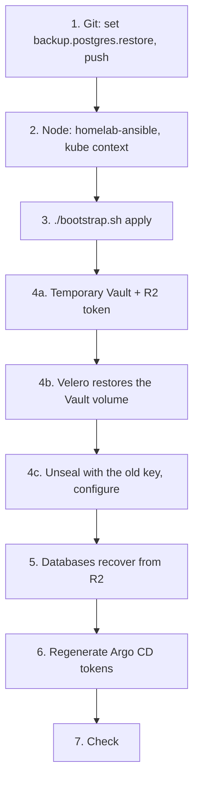

# Disaster recovery (rebuild the node from scratch)

## What this is about

How to rebuild the **same** lab with its data after losing the node: what git restores by itself, and what needs a
backup or a manual step, in order. For an empty lab without data, use [first-install.md](first-install.md).

## When to use it

- The node's disk is lost, or the cluster must be rebuilt from zero.
- Vault and the databases must come back with their old content.

> **Warning:** nothing here is automated, on purpose. Run it only in a real recovery: several steps delete volumes.

## Before you start

You need these **outside** the cluster (keep them there before any disaster):

- `~/.config/homelab/vault-init.json` (unseal key and root token), with an offline copy in the password manager.
- The **R2 API token** (access key id, secret access key, endpoint), in the same password manager. Velero needs it to
  restore Vault, and it normally lives *in* Vault (`homelab/velero`): the offline copy breaks that circle.
- The Cloudflare zone file `~/.config/homelab/staffops.space.zone` and the cluster's Cloudflare API token, or a way to
  mint a new one ([first-install.md](first-install.md#0-once-per-domain-cloudflare)).
- The `velero` and `argocd` CLIs, and push access to this repository.

## What comes back, and from where

**Git alone restores** everything declared in the three repositories: the node (homelab-ansible), Argo CD and every
platform app (homelab-gitops), workload apps (homelab-gitops-apps), dashboards, alerts, Kyverno policies (ambient
labels, Pod zone), DNS records (external-dns) and certificates (cert-manager).

| State | Comes back from | Step |
|-------|-----------------|------|
| Every secret (`secret/homelab/*`) | Velero backup of namespace `vault` (R2 `k8s01/`) + the **old** unseal key | 4 |
| PostgreSQL: Keycloak (users, group memberships, master-realm clients), Dependency-Track (projects, API keys), Harbor (projects, users, policies), Argo Workflows (archive), DefectDojo, Grafana (users, preferences, service-account tokens) | CloudNativePG base backups + WAL in R2 (`cnpg/<cluster>/`), point in time | 1 + 5 |
| Argo CD API tokens (accounts `mcp`, `argo-workflows`) | Regenerated: a new Argo CD signs with a new key | 6 |
| Metrics, logs, traces, Harbor images, DefectDojo uploads | Not backed up (accepted) | — |

What each backup contains: [backup.md](backup.md#what-is-backed-up-and-where).

## Recovery order



## Procedures

### 1. Before bootstrapping: point the databases at their backups (git)

If the Clusters start with `initdb`, CloudNativePG creates **empty** databases, and the Barman Cloud plugin refuses to
archive into the existing backup path. So, before step 3:

1. Uncomment the restore keys under `backup.postgres` in `helm-charts/environment.yaml`:

    ```yaml
            restore: true
            # restoreTargetTime: "2026-11-15 10:00:00+00"   # optional point in time; default: the latest WAL
            restoreFromSuffix: ""                           # "" the first time; "-r1" if the backups came from a previous recovery
            serverSuffix: "-r1"                             # new WAL archive path: never reuse one
    ```

2. Render and push ([gitops-workflow.md](../gitops-workflow.md)):

    ```bash
    scripts/render-app.sh --all
    ```

Expect: every CloudNativePG Cluster (`keycloak-db`, `dtrack-db`, `harbor-db`, `workflows-db`, `defectdojo-db`,
`grafana-db`) renders `bootstrap.recovery` from its ObjectStore (`<cluster>-r2`,
`serverName: <cluster><restoreFromSuffix>`) instead of `initdb`, and archives new WAL under `<cluster><serverSuffix>`.

> **Note:** the recovering Clusters wait and retry until their R2 credentials exist, which needs Vault (step 4).
> Without the keys, the templates render exactly as before.

### 2. Node

Run `homelab-ansible` (kubeadm, Calico, GPU, CoreDNS with 2 replicas), then recreate the kube context `k8s01`
([node.md](node.md#recreate-the-kube-context-on-the-mac)).

Expect: `kubectl --context k8s01 get nodes` shows `k8s01` Ready.

### 3. Bootstrap

```bash
./bootstrap.sh apply
```

Expect: Argo CD syncs every app ([first-install.md](first-install.md#3-bootstrap)). The apps that need secrets stay
degraded until step 4.

### 4. Vault: restore the secrets

The new Vault starts empty, and Velero needs the R2 token to read the backup. So you bring up a temporary Vault
first, only to hold that token.

1. Move the real `vault-init.json` aside. Initialise a temporary Vault and give it the R2 token from the offline copy:

    ```bash
    scripts/vault.sh init
    scripts/vault.sh configure
    scripts/vault.sh put velero access-key-id secret-access-key endpoint
    kubectl --context k8s01 -n velero get backupstoragelocation default
    ```

    Expect: the storage location is `Available`.

2. Replace the temporary Vault data with the backed-up one.

    > **Warning:** this deletes the temporary Vault volume. Make sure the real `vault-init.json` is safe first.

    ```bash
    kubectl --context k8s01 -n vault scale statefulset vault --replicas=0
    kubectl --context k8s01 -n vault delete pvc --all
    velero --kubecontext k8s01 backup get                      # pick the latest Completed backup
    velero --kubecontext k8s01 restore create --from-backup <backup> --include-namespaces vault \
        --include-resources persistentvolumeclaims,persistentvolumes,pods
    kubectl --context k8s01 -n vault scale statefulset vault --replicas=1
    ```

    Expect: `vault-0` Running, sealed. Argo CD keeps the rest of the namespace (it owns those objects); only the data
    volume comes from Velero.

3. Put the **original** `vault-init.json` back in `~/.config/homelab/`, then unseal and refresh the configuration:

    ```bash
    scripts/vault.sh unseal
    scripts/vault.sh configure
    scripts/vault.sh autounseal-secret
    ```

    Expect: `Sealed: false`. The restored Vault has the old secrets, policies and roles (`external-secrets`, `apps`);
    `configure` is idempotent and points Kubernetes auth at the new cluster's API.

4. [Force a refresh](vault.md#force-a-refresh) of the ExternalSecrets.

    Expect: all `SecretSynced`.

### 5. Databases

With Vault back, the Clusters from step 1 get their R2 credentials and recover.

```bash
kubectl --context k8s01 get clusters.postgresql.cnpg.io -A
```

Expect: "Cluster in healthy state" for each. Then Keycloak, Dependency-Track, Harbor, Argo Workflows, DefectDojo and
Grafana become Healthy. Keycloak gets back its users, group memberships and the master-realm client
`keycloak-config-cli`; the realm import re-applies clients and groups from git on top.

If one is stuck:

```bash
kubectl --context k8s01 -n <namespace> logs <cluster>-1-full-recovery-<suffix>
```

After the recovery, set `restore` back to false (comment it) but **keep `serverSuffix` set**: it is now where the
live backups go, and the next recovery uses it as `restoreFromSuffix`. Render and push.

### 6. Tokens that cannot be restored

A new Argo CD signs tokens with a new key. Generate them again as an Argo CD admin and write them back:

```bash
argocd account generate-token --account mcp              # → vault kv patch secret/homelab/mcp argocd-token=<token>
argocd account generate-token --account argo-workflows   # → vault kv patch secret/homelab/argo-workflows argocd-token=<token>
```

Then [force a refresh](vault.md#force-a-refresh) of `mcp-servers/mcp-credentials` and
`argo-workflows/argocd-token`.

Expect: the MCP servers and the `argocd-sync` workflow template work again.

### 7. Check

- [first-install.md](first-install.md#5-check).
- All Argo CD apps Synced/Healthy: `kubectl --context k8s01 -n argo get applications`.
- A new completed backup per cluster: `kubectl --context k8s01 get backups.postgresql.cnpg.io -A`.
- Grafana → Observability → Alerts overview is empty.
- Logins through Keycloak work for every tool ([sso.md](sso.md#tools-and-roles)).

## If it goes wrong

- Storage location never `Available` in step 4: the R2 token or endpoint from the offline copy is wrong
  ([backup.md](backup.md#if-it-goes-wrong)).
- Vault does not unseal: you are using the temporary `vault-init.json`, not the original one.
- A database starts empty: step 1 was not pushed before step 3. Delete that Cluster, push the restore keys, and let
  Argo CD recreate it.
- Upstream reference for the database restore: https://cloudnative-pg.io/plugin-barman-cloud/docs/usage/ (restore section).
