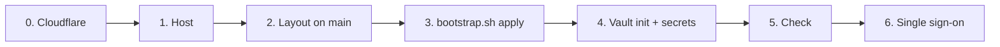

# First install (or full rebuild without data)

## What this is about

How to go from an empty kubeadm cluster to every platform app synced by Argo CD. Order matters only for secrets:
apps that need one keep retrying until Vault has it.

## When to use it

- A brand-new lab.
- A rebuild where you do **not** want the old data back. To keep the data, use
  [disaster-recovery.md](disaster-recovery.md).

## Before you start

- The node built by the Ansible repository `homelab-ansible`: node Ready with Calico, control-plane taint removed.
- Kube context `k8s01` on your machine ([node.md](node.md#recreate-the-kube-context-on-the-mac)).
- Push access to this repository on GitHub.
- A Cloudflare account and the domain `staffops.space` at Hostinger (step 0, once per domain).
- A password manager for the Vault init file and the generated secrets.



## Procedures

### 0. Once per domain: Cloudflare

Other hosts (the VPS) also use `staffops.space`: their records must be on Cloudflare **before** the nameservers move.
They live in a BIND file outside the repository, `~/.config/homelab/staffops.space.zone`. The lab's own records are
not there: external-dns creates them.

1. Cloudflare → My Profile → API Tokens → Create Custom Token (bootstrap, temporary) with: Account Settings Read,
   Zone Edit, DNS Edit, User API Tokens Edit.
2. Create the zone, import the zone file and mint the cluster token:

    ```bash
    scripts/cloudflare-setup.sh setup
    ```

    Expect: it prints the two nameservers and writes the cluster token to `~/.config/homelab/cloudflare-api-token`.
    It fails if any record of the zone file is missing.

3. Check the imported records in the Cloudflare dashboard. Then at Hostinger (domain → Nameservers), set the two
   Cloudflare nameservers.
4. Wait for the zone to become active (minutes to hours):

    ```bash
    scripts/cloudflare-setup.sh status
    ```

    Expect: `active`. Then delete the bootstrap token.

The cluster token goes to Vault in step 4.

### 1. Host

Build the node with `homelab-ansible` and create the kube context ([node.md](node.md)).

Expect: `kubectl --context k8s01 get nodes` shows `k8s01` Ready.

### 2. Repository layout on `main`

Argo CD syncs `origin/main`, not your local checkout. Push the layout before bootstrapping
([gitops-workflow.md](../gitops-workflow.md)).

### 3. Bootstrap

```bash
./bootstrap.sh diff     # read the checks; nothing is applied
./bootstrap.sh apply    # Gateway API + prometheus-operator CRDs, Argo CD, root Application
./bootstrap.sh status   # wait until the ApplicationSet created the platform Applications
```

Expect: `local-path-provisioner`, `metrics-server`, `kubelet-csr-approver`, `metallb`, `vault` and `istio` sync on
their own (Vault's volume binds once the StorageClass exists). Every app that reads a Vault secret (for example
`cert-manager`, `external-dns`, `monitoring`, `keycloak`, `dependency-track`, `velero`, `harbor`, `defectdojo`,
`argo-workflows`, `mcp-servers`, `llm`, `opentelemetry`) stays degraded until step 4. That is expected.

> **Note:** every namespace except `kube-*`, `istio-system`, `calico-system` and `tigera-operator` runs in Istio
> [ambient mode](../glossary.md) (Kyverno labels them). A NetworkPolicy in those namespaces must allow TCP 15008
> (ztunnel's HBONE port) and `169.254.7.127/32` (kubelet probes).

### 4. Vault

1. Initialise and configure Vault:

    ```bash
    scripts/vault.sh init                 # saves ~/.config/homelab/vault-init.json — copy it offline now
    scripts/vault.sh configure            # KV v2, Kubernetes auth, role external-secrets
    scripts/vault.sh autounseal-secret    # lets the CronJob unseal Vault after a reboot
    ```

    Expect: `scripts/vault.sh status` shows `Sealed: false`.

2. Write every platform secret. The full list, with the keys and how to generate each value, is the table
   [Secrets the platform expects](vault.md#secrets-the-platform-expects). The usual order:

    ```bash
    scripts/vault.sh put cloudflare api-token
    scripts/vault.sh put grafana admin-user admin-password
    scripts/vault.sh put keycloak admin-user admin-password
    scripts/vault.sh put oidc argocd grafana vault hermes backstage keycloak-mcp     # random client secrets
    scripts/vault.sh put dependency-track kek admin-password
    scripts/vault.sh put velero access-key-id secret-access-key endpoint            # R2 token, see backup.md
    scripts/vault.sh put harbor admin-password secret-key oidc-client-secret
    scripts/vault.sh put defectdojo admin-password secret-key credential-aes-key
    scripts/vault.sh put otel external-token
    scripts/vault.sh put llm api-key
    ```

    Some secrets can only be written later, once their tool runs:
    - `keycloak-automation` (`client-secret`): after Keycloak is up, see [sso.md](sso.md#automation-client-for-the-realm-import);
    - `mcp` (`argocd-token`, `grafana-token`, `dependency-track-api-key`) and `argo-workflows` (`argocd-token`): tokens
      created in Argo CD, Grafana and Dependency-Track ([argo-workflows.md](argo-workflows.md#secrets)). Write
      `argo-workflows` with its `oidc-client-secret` first.

3. External Secrets picks the values up within an hour. To speed it up, [force a refresh](vault.md#force-a-refresh).

The R2 bucket and token come from [backup.md](backup.md#one-time-setup-r2-bucket-and-token).

### 5. Check

```bash
kubectl --context k8s01 get clustersecretstore vault                 # Ready=True
kubectl --context k8s01 get externalsecrets -A                       # all SecretSynced
kubectl --context k8s01 -n gateway get certificate wildcard          # Ready=True (DNS-01 can take ~2 min)
kubectl --context k8s01 -n gateway get gateway public                # address 192.168.68.240, Programmed
dig +short argocd.staffops.space                                     # 192.168.68.240
```

Then open `https://argocd.staffops.space`: user `admin`, password in Secret `argocd-initial-admin-secret`. Change the
password and delete that Secret.

### 6. Single sign-on

Once `keycloak` is Healthy, follow [sso.md](sso.md#first-time-setup): Keycloak admin and user, then
`scripts/vault.sh oidc`.

## If it goes wrong

- An app stays degraded after step 4: its ExternalSecret is not `SecretSynced`; see [vault.md](vault.md#if-it-goes-wrong).
- An app is OutOfSync or shows a `ComparisonError`: [argocd.md](argocd.md#an-app-is-outofsync-or-degraded).
- `bootstrap.sh` refuses to run: the context is not `k8s01`, or the control-plane taint is still on the node
  ([node.md](node.md)).
- The certificate stays not Ready: check the Cloudflare token (Vault `homelab/cloudflare`) and the zone status
  (`scripts/cloudflare-setup.sh status`).
