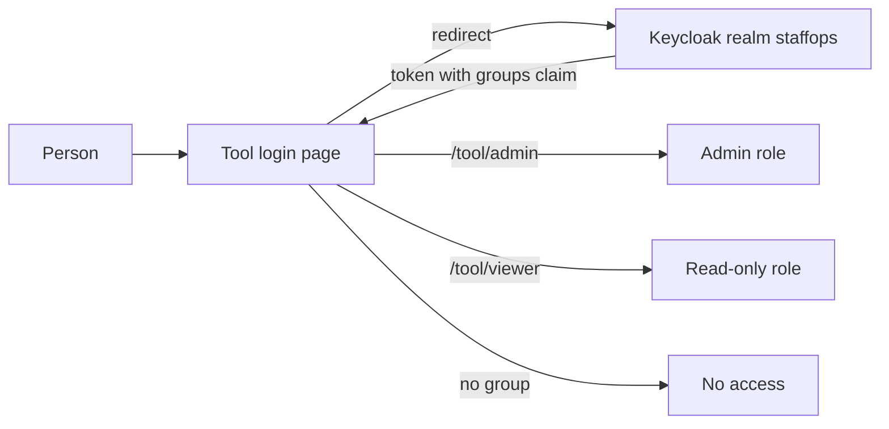

# Single sign-on (Keycloak)

## What this is about

Keycloak (`https://keycloak.staffops.space`) is the single login for the lab's tools. Access is given by joining
Keycloak groups; each tool maps its two groups to its own admin and read-only roles.

## When to use it

- Someone needs access to a tool, or must lose it.
- You add a tool that should log in through Keycloak.
- You rotate an OIDC client secret.
- The realm import Job fails with `401`.
- First install or rebuild: create the first admin and user.

## Before you start

- Kube context `k8s01`.
- Vault unsealed and `scripts/vault.sh` working ([vault.md](vault.md)).
- A Keycloak admin login (realm `master`). On a fresh install, the bootstrap admin is in Vault `homelab/keycloak`.

## How it works

The realm is `staffops` (`keycloak.realm` in `helm-charts/environment.yaml`). The PostSync Job
`keycloak/keycloak-realm-import` (keycloak-config-cli, `helm-charts/keycloak/keycloak-raw`) applies it from git after
every sync of the `keycloak` app.

For every tool in `keycloak.apps` the realm has two groups, `/<tool>/admin` and `/<tool>/viewer`. The token claim
`groups` carries the full path (`/argocd/admin`), so each tool only reacts to its own groups.



### Tools and roles

| Tool | Login button | `/<tool>/admin` | `/<tool>/viewer` | Other users |
|------|--------------|-----------------|------------------|-------------|
| Argo CD | "Log in via Keycloak" | `role:admin` | `role:readonly` | no access |
| Grafana | "Sign in with Keycloak" | Admin | Viewer | login refused |
| Vault | method OIDC, role `default` | policy `admin` | policy `viewer` (read/list) | `default` policy only |
| Dependency-Track | "Login with Keycloak" | team *Administrators* | team *Viewers* (VIEW_PORTFOLIO, VIEW_VULNERABILITY, VIEW_POLICY_VIOLATION) | no permissions |
| Harbor | "Login via OIDC provider" | system admin | onboarded user; project access by adding the group to a project | onboarded, no project access |
| Argo Workflows | "Login" (SSO) | ClusterRole `argo-workflows-admin` | ClusterRole `argo-workflows-view` | no access |
| MCP servers | Keycloak JWT on each request | allowed | allowed | rejected by the Gateway ([MCP servers](#mcp-servers)) |

Not in Keycloak: **DefectDojo** has local accounts only (admin `admin`, password in Vault `homelab/defectdojo`). SSO is
a DefectDojo Pro feature since [3.0](https://docs.defectdojo.com/releases/os_upgrading/3.0/).

### Client secrets

| Client | Vault path and key |
|--------|--------------------|
| `argocd`, `grafana`, `vault`, `hermes`, `keycloak-mcp` | `homelab/oidc`, key = client name |
| `harbor` | `homelab/harbor`, `oidc-client-secret` |
| `argo-workflows` | `homelab/argo-workflows`, `oidc-client-secret` |
| `backstage` | `homelab/backstage`, `oidc-client-secret` (overrides the old `homelab/oidc` key `backstage`) |
| `dependency-track` | none: public client (browser login, PKCE) |

### Break-glass local logins

Argo CD `admin`, Grafana `admin` (Vault `homelab/grafana`), Harbor `admin` (Vault `homelab/harbor`),
Dependency-Track `admin` (Vault `homelab/dependency-track`, `admin-password`), Vault root token.

## Procedures

### Give a person access

Memberships live in Keycloak (its database), not in git.

1. Open `https://keycloak.staffops.space/admin` → realm `staffops` → Users → the user → Groups.
2. Join `/<tool>/admin` or `/<tool>/viewer` for each tool the person needs.

Expect: at the next login, the person gets the matching role. To remove access, leave the group.

### First-time setup

1. Open `https://keycloak.staffops.space/admin` with the bootstrap admin from Vault `homelab/keycloak`. In realm
   `master`, create a permanent admin, then delete the temporary one.
2. Create the [automation client](#automation-client-for-the-realm-import), then re-sync the `keycloak` app so the
   realm import runs.
3. Realm `staffops` → Users → create your user (email verified, set a password) → Groups → join the `admin` or
   `viewer` subgroup of each tool.
4. Configure Vault's OIDC login (once; idempotent):

    ```bash
    scripts/vault.sh oidc
    ```

    Expect: the Vault UI offers method OIDC, role `default`; `/vault/admin` gets policy `admin`.

5. Dependency-Track (lives in its database, done 2026-11-15; redo only on a new, empty database) through
   Administration → Access Management:
    - change the local `admin` password from the install default and store it in Vault `homelab/dependency-track`
      (`admin-password`, with `vault kv patch`);
    - map OpenID Connect groups `/dependency-track/admin` → team *Administrators* and `/dependency-track/viewer` →
      team *Viewers*;
    - create team *MCP (read-only)* (VIEW_PORTFOLIO, VIEW_VULNERABILITY, VIEW_POLICY_VIOLATION) and store its API key
      in Vault `homelab/mcp` (`dependency-track-api-key`).

### Automation client for the realm import

The realm import Job logs in as the master-realm client `keycloak-config-cli` (client_credentials), never as a
person. Create it once in the admin console:

1. Realm `master` → Clients → Create client → Client ID `keycloak-config-cli` → Next → *Client authentication* on,
   *Service accounts roles* on, other flows off → Save.
2. Tab *Service accounts roles* → Assign role → filter *realm roles* → `admin`.
3. Tab *Advanced* → *OpenID Connect Compatibility Modes* → **Use refresh tokens for client credentials grant: Off**.
4. Tab *Client scopes* → Add client scope → `kc-admin-api` → Add → **Default**.
5. Tab *Credentials* → copy the client secret, then store it:

    ```bash
    scripts/vault.sh put keycloak-automation client-secret
    ```

Expect: the next `keycloak-realm-import` Job completes.

> **Note:** since Keycloak 26.8.2 the Admin REST API answers `401` to any token without the `kc-admin-api` scope (only
> `admin-cli` and `security-admin-console` get it on upgrade). The refresh-token option is deprecated in Keycloak 26.8
> and not needed.

### Add a tool

1. Add it to `keycloak.apps` in `helm-charts/environment.yaml` (creates its two groups on the next sync).
2. Create its client in `keycloak-raw`.
3. Map `/<tool>/admin` and `/<tool>/viewer` in the tool's own config.
4. Add a row to the [tools table](#tools-and-roles) and its secret to [vault.md](vault.md#secrets-the-platform-expects).

### Rotate a client secret

> **Warning:** `put` replaces the whole secret. `homelab/oidc` holds six keys: pass all of them, or rotate one key
> with `vault kv patch secret/homelab/oidc <client>=<value>`.

1. Write the new value:

    ```bash
    scripts/vault.sh put oidc argocd grafana vault hermes backstage keycloak-mcp
    ```

2. Refresh the `keycloak` app:

    ```bash
    kubectl --context k8s01 -n argo annotate application keycloak argocd.argoproj.io/refresh=hard --overwrite
    ```

3. [Force a refresh](vault.md#force-a-refresh) of the ExternalSecrets that carry client secrets:
   `argo/argocd-oidc`, `monitoring/grafana-oidc`, `keycloak/keycloak-oidc-clients`, `mcp-servers/mcp-credentials`.
4. Re-sync the `keycloak` app (runs the realm import), restart Grafana, and run `scripts/vault.sh oidc` again.

Expect: login works on every tool whose secret changed.

## MCP servers

`https://mcp.staffops.space/<name>`, where `<name>` is `kubernetes`, `grafana`, `argocd`, `dependency-track`,
`keycloak`, `prometheus`, `kubectl` or `tempo`. All are read-only (keycloak-mcp has write tools, but its service
account only holds realm-management view/query roles).

The `mcp` Gateway rejects any request without a Keycloak JWT of realm `staffops` whose `groups` contain `/mcp/admin`
or `/mcp/viewer` (gateway-raw: RequestAuthentication + AuthorizationPolicy). People join one of those groups.
Services use their own client with client_credentials (`hermes`, secret in Vault `homelab/oidc`; `backstage`, which
also does the browser login, secret in `homelab/backstage` `oidc-client-secret`); their
service-account users are in `/mcp/viewer`:

```bash
curl -s https://keycloak.staffops.space/realms/staffops/protocol/openid-connect/token \
    -d grant_type=client_credentials -d client_id=hermes -d client_secret=<secret> | jq -r .access_token
# then: Authorization: Bearer <token> on https://mcp.staffops.space/kubernetes
```

- New service: add it to the client list in `keycloak-raw` (clients and users), add its secret to `homelab/oidc`, sync.
- New MCP server: a Deployment/Service in `helm-charts/mcp-servers` and a rule in its route.

## Check

- Log in to each tool with "Log in via Keycloak" (or its equivalent) and confirm the role.
- `kubectl --context k8s01 -n keycloak get jobs` shows the last `keycloak-realm-import` as complete.

## If it goes wrong

- Realm import fails with `401`: the automation client lacks the `kc-admin-api` default scope (step 4 above).
- A tool says "invalid client secret": the ExternalSecret did not refresh, or Keycloak and the tool hold different
  values. Redo [Rotate a client secret](#rotate-a-client-secret) from step 2.
- MCP `401`: no or expired token. MCP `403`: the token has no `/mcp/*` group.
- Locked out of a tool: use its [break-glass local login](#break-glass-local-logins).
