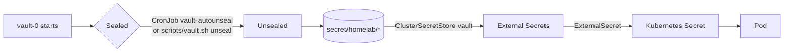

# Vault

## What this is about

Vault is the lab's only secret store. It runs as `vault/vault-0` (standalone, file storage on a 5 Gi `local-path`
volume) and holds every credential under `secret/homelab/*`. This runbook covers unsealing, writing secrets and
fixing External Secrets.

## When to use it

- Alert `VaultSealed`, or the node was rebooted.
- You add an app that needs a credential, or you rotate one.
- An ExternalSecret shows `SecretSyncedError`, or `ClusterSecretStore vault` is not Ready.
- The Vault volume is lost.

## Before you start

- Kube context `k8s01` (see [node.md](node.md#recreate-the-kube-context-on-the-mac)).
- The init file `~/.config/homelab/vault-init.json` (unseal key and root token, mode 600). Override the path with
  `VAULT_INIT_FILE=…`. Keep an offline copy in a password manager.
- `scripts/vault.sh` does almost everything. It pins context `k8s01` and passes tokens and values on stdin, so
  nothing ends up in your shell history.

> **Note:** the `vault` namespace runs in Istio ambient mode, like every namespace except `kube-*`, `istio-system`,
> `calico-system` and `tigera-operator` (Kyverno labels them). See [ambient mode](../glossary.md) and
> [architecture.md](../architecture.md).

## How it works

Vault starts **sealed**: it holds its data encrypted and cannot read it until someone gives it the unseal key.



External Secrets logs in to Vault (Kubernetes auth, role `external-secrets`), reads the keys named in each
[ExternalSecret](../glossary.md) and writes a Kubernetes Secret. Pods read that Secret. It refreshes every hour.

## Procedures

### Vault is sealed

The CronJob `vault/vault-autounseal` runs every 5 minutes and unseals `vault-0` with the key in Secret
`vault/vault-unseal` (not in git). A reboot therefore heals itself within 5 minutes.

1. Unseal now instead of waiting:

    ```bash
    kubectl --context k8s01 -n vault create job --from=cronjob/vault-autounseal unseal-now
    ```

    Expect: the Job completes and `scripts/vault.sh status` shows `Sealed: false`.

2. If the Secret `vault-unseal` is missing, unseal by hand, then recreate the Secret so the next reboot heals itself:

    ```bash
    scripts/vault.sh status                 # Sealed: true
    scripts/vault.sh unseal
    scripts/vault.sh autounseal-secret
    ```

    Expect: `Sealed: false`.

> **Note:** while Vault is sealed, existing Kubernetes Secrets keep working. ExternalSecrets fail to refresh and new
> ones stay pending. The Vault Pod stays Ready on purpose (its readiness probe accepts sealed/uninitialized), so
> `https://vault.staffops.space` still answers and you can also unseal from the UI.

### Write or rotate a platform secret

1. Write the secret. The script prompts for each key with a hidden prompt:

    ```bash
    scripts/vault.sh put <name> <key> [<key>…]
    ```

    Expect: the secret is written to `secret/homelab/<name>`.

    > **Warning:** `put` replaces the **whole** secret. Pass every key of that secret each time, or the missing ones
    > are deleted. To add or change a single key, use `vault kv patch` instead (after `vault login` with the root token
    > or an OIDC admin):
    >
    > ```bash
    > vault kv patch secret/homelab/<name> <key>=<value>
    > ```

2. Force External Secrets to pick it up now ([Force a refresh](#force-a-refresh)).
3. Restart the workload if it reads the value from an environment variable: Pods read Secrets at start.

### Force a refresh

```bash
kubectl --context k8s01 -n <namespace> annotate externalsecret <name> force-sync=$(date +%s) --overwrite
kubectl --context k8s01 get externalsecrets -A
```

Expect: `SecretSynced` on every ExternalSecret.

### Write a secret for a workload app

Workload apps (repository `homelab-gitops-apps`) use the path `secret/homelab/apps/<namespace>/<name>`. Write it
yourself with the `vault` CLI on the Mac, logged in as an admin (OIDC, group `/vault/admin`):

```bash
export VAULT_ADDR=https://vault.staffops.space
vault login -method=oidc        # opens the browser (Keycloak); the root token also works: vault login
```

Then:

```bash
vault kv put secret/homelab/apps/<namespace>/<name> <key>=<value>
```

Expect: the app's ExternalSecret becomes `SecretSynced` within an hour, or at once after a
[forced refresh](#force-a-refresh).

> **Note:** the app reads it through its own SecretStore `vault` (ServiceAccount `vault-reader`, Kubernetes auth role
> `apps`). `scripts/vault.sh configure` creates that role and the templated policy `apps-read`: only ServiceAccounts
> `vault-reader` of namespaces labelled `staffops.space/tier=apps` can log in, each limited to its own namespace path.
> Vault reads the Namespace to check the label (ClusterRole `vault-namespace-read` in vault-raw). The platform's
> ClusterSecretStore `vault` only serves `platform.namespaces` in `helm-charts/environment.yaml`: add new platform
> namespaces there.

### External Secrets cannot authenticate

Symptoms: `ClusterSecretStore vault` not Ready, events with `permission denied` or `403`.

1. Check that Vault is unsealed:

    ```bash
    scripts/vault.sh status
    ```

    Expect: `Sealed: false`. If not, see [Vault is sealed](#vault-is-sealed).

2. Recreate the mount, auth, policy and role. The command is idempotent:

    ```bash
    scripts/vault.sh configure
    ```

    Expect: `kubectl --context k8s01 get clustersecretstore vault` shows `Ready=True`.

3. If it still fails: the role is bound to ServiceAccount `external-secrets/external-secrets`. The External Secrets
   chart uses `fullnameOverride: external-secrets` for that reason; check it was not changed.

On the **VPS k3s** (ADR 0008) the ClusterSecretStore has the same name and reads the same paths, through the auth
mount `kubernetes-vps`: Vault reviews the VPS ServiceAccount token against the k3s API over the tailnet. Recreate it
with `scripts/vault.sh configure-vps` (idempotent; needs `homelab/argocd-cluster-vps`, it reads the k3s CA from it).
If a VPS store is not Ready: Vault must reach `https://100.81.185.50:6443` (Calico mark mask, homelab-ansible), and
the reviewer token (`homelab/vault-reviewer-vps`, ServiceAccount `kube-system/vault-token-reviewer`) must be valid.

### Lost the Vault volume

1. Move the old init file away, then initialise the empty Vault and configure it:

    ```bash
    scripts/vault.sh init
    scripts/vault.sh configure
    scripts/vault.sh configure-vps    # after homelab/argocd-cluster-vps is back (it reads its ca-data)
    ```

    Expect: a new `~/.config/homelab/vault-init.json`. Copy it offline now.

2. `put` every secret of the [table below](#secrets-the-platform-expects) again, from the password manager.
3. Recreate the auto-unseal Secret with `scripts/vault.sh autounseal-secret`.

The platform recovers on the next ExternalSecret refresh. To get the old secrets back instead of retyping them,
restore the Vault volume from Velero ([disaster-recovery.md](disaster-recovery.md#4-vault-restore-the-secrets)).

## Secrets the platform expects

Every path below is `secret/homelab/<name>`, read by an ExternalSecret through `ClusterSecretStore vault`. When you
add an app with a secret, add a row here.

| Path | Keys | Used by | Notes |
|------|------|---------|-------|
| `cloudflare` | `api-token` | cert-manager, external-dns | Cluster token from `scripts/cloudflare-setup.sh setup` |
| `grafana` | `admin-user`, `admin-password` | Grafana | Local break-glass admin |
| `keycloak` | `admin-user`, `admin-password` | Keycloak | Bootstrap admin, first start only |
| `keycloak-automation` | `client-secret` | Keycloak realm import Job | [sso.md](sso.md#automation-client-for-the-realm-import) |
| `oidc` | `argocd`, `grafana`, `vault`, `hermes`, `backstage`, `keycloak-mcp` | Keycloak clients, Argo CD, Grafana, Vault, MCP server keycloak | Random strings; see [sso.md](sso.md) |
| `otel` | `external-token` | otel-gateway external receiver | Token the VPS sends |
| `mcp` | `argocd-token`, `grafana-token`, `dependency-track-api-key` | MCP servers | Argo CD account `mcp` token, Grafana service-account token, API key of a Dependency-Track VIEW_* team |
| `mcp-vps` | `token`, `ca.crt` | MCP servers /kubernetes and /kubectl (kubeconfig context `vps`) | Token and CA of ServiceAccount `mcp-servers/mcp-reader` on the VPS k3s (Secret `mcp-reader-token`, created by platform-vps `mcp-servers`; read-only ClusterRole `mcp-read`). Rotate: delete the Secret there, copy the new one |
| `argocd-ghcr-charts` | `username`, `token` | helmfile plugin of Argo CD (Secret `argocd-render-env`: `GHCR_CHARTS_USERNAME`, `GHCR_CHARTS_TOKEN`); image-scan workflow (Secret `image-scan-scan` in argo-workflows: `GHCR_USERNAME`, `GHCR_TOKEN`, detect and scan steps) | GitHub login + classic PAT with only `read:packages`, to pull the private charts `oci://ghcr.io/staffops/charts` (StaffOps/private-helm-charts) and to read the private images of the orgs for the scan. Renew before it expires; hard-refresh the apps that use them |
| `backstage` | `app-id`, `client-id`, `private-key`, `argocd-token`, `k8s01-token`, `k8s01-ca`, `vps-token`, `vps-ca`, `grafana-token`, `dependency-track-api-key`, `auth-session-secret`, `oidc-client-secret`; pending the TechDocs decision: `techdocs-access-key-id`, `techdocs-secret-access-key` | Backstage platform app (`helm-charts/backstage`: Secret `backstage-credentials`, files under `/run/secrets`, `argo-workflows.token` = `k8s01-token`; `*.authorization` built by External Secrets as `Bearer <token>`) and the Keycloak realm import (`oidc-client-secret` = client `backstage`); local compose copies in ~/.config/backstage/, mode 600 | `auth-session-secret`: random (`openssl rand -hex 32`). `oidc-client-secret`: secret of the Keycloak client `backstage` (browser login + client_credentials for the MCP servers); it replaces `homelab/oidc` key `backstage`, so copy that value here first to keep the MCP calls working. `techdocs-*`: read-only R2 token of bucket `staffops-techdocs`.  `app-id`/`client-id`/`private-key`: GitHub App `staffops-backstage` (owner StaffOps, app id 5811537), installed with all repositories on StaffOps, PersonalAIgent, StaffOps-Mentoring and the user karlipegomes; read: actions, checks, statuses, members, metadata; write: administration, contents, pull requests, workflows. Public only so other accounts can install it; restrict with `allowedInstallationOwners`. Rotate: new private key in the App settings, `vault kv patch … private-key=-` from the .pem on stdin, delete the old key. `argocd-token`: Argo CD account `backstage` (role:readonly; `argocd account generate-token --core --account backstage` with a kubeconfig whose namespace is argo). `k8s01-*`/`vps-*`: ServiceAccount `mcp-servers/backstage-reader` (ClusterRole backstage-read: workloads, services, routes, events, metrics; no Secrets, ConfigMaps or logs) on each cluster; rotate by deleting Secret backstage-reader-token. `grafana-token`: service account `backstage` (Viewer). `dependency-track-api-key`: DT team `backstage` (VIEW_PORTFOLIO, VIEW_VULNERABILITY). Use `vault kv patch`, never `put` (it drops the other keys) |
| `dependency-track-upload` | `api-key` | image-scan workflow (argo-events release `image-scan`, Secret `image-scan-scan` in argo-workflows, upload step only) | API key of the Dependency-Track team `golden-images-scan` (BOM_UPLOAD, PROJECT_CREATION_UPLOAD, VIEW_PORTFOLIO, PORTFOLIO_MANAGEMENT_READ/CREATE/UPDATE/DELETE: it keeps the Domain → System → image tree and deletes untracked versions). Rotate: new key on the team in DT (Administration → Teams), put it here |
| `trivy-server` | `token` | Trivy server in dependency-track (env TRIVY_TOKEN) and Dependency-Track's Trivy analyzer (DT secret `trivy-token`) | Random (`openssl rand -hex 32`). Rotate: new value here, restart deploy/trivy, update the DT secret `trivy-token` (Administration → Secrets) |
| `llm` | `api-key` | llama.cpp server | Clients send `Authorization: Bearer <key>` to `llm.staffops.space` |
| `dependency-track` | `kek`, `admin-password` | Dependency-Track | `kek`: `openssl rand -base64 32`, keep a copy (losing it loses the secrets DT stores). `admin-password`: local `admin`, break-glass, not read by the cluster |
| `velero` | `access-key-id`, `secret-access-key`, `endpoint` | Velero, every CloudNativePG ObjectStore, Argo CD render env | R2 API token, see [backup.md](backup.md#one-time-setup-r2-bucket-and-token) |
| `harbor` | `admin-password`, `secret-key`, `oidc-client-secret` | Harbor, Keycloak realm import | `secret-key`: exactly 16 characters, `openssl rand -hex 8`, keep it. `oidc-client-secret`: any random string, the Keycloak client `harbor` uses the same value |
| `argo-workflows` | `oidc-client-secret`, `argocd-token` | Argo Workflows, Keycloak realm import | Token of the Argo CD account `argo-workflows`, see [argo-workflows.md](argo-workflows.md#secrets) |
| `argo-workflows-r2` | `access-key-id`, `secret-access-key` | Argo Workflows artifact repository (Secret `argo-workflows-r2` in argo-workflows; readable by argo-server callers, Backstage's reader included) | R2 API token with Object Read & Write on the bucket `staffops-k8s-argo-workflows` only, never the Velero token. Rotate: new token in Cloudflare (R2 → Manage API tokens), put it here, force-sync the ExternalSecret |
| `defectdojo` | `admin-password`, `secret-key`, `credential-aes-key` | DefectDojo | `admin-password`: local `admin`, `openssl rand -base64 24`, used only when the user is created. `secret-key`: Django `SECRET_KEY`, `openssl rand -hex 64`, keep it (sessions; the metrics password is derived from it). `credential-aes-key`: `openssl rand -hex 64`, keep a copy (losing it loses the secrets DefectDojo stores encrypted) |
| `vault-reviewer-vps` | `token` | Vault auth mount `kubernetes-vps` (token reviewer) | Token of ServiceAccount `kube-system/vault-token-reviewer` on the VPS k3s (TokenReview + read Namespaces), created by the VPS Ansible; after changing it run `scripts/vault.sh configure-vps` |
| `argocd-cluster-vps` | `token`, `ca-data` | Argo CD cluster Secret `vps` (ADR 0008) | `token`: long-lived token of the ServiceAccount Argo CD uses on the VPS k3s. `ca-data`: base64 of the k3s server CA |
| `apps/<namespace>/<name>` | app-specific | Workload apps (homelab-gitops-apps) | [Write a secret for a workload app](#write-a-secret-for-a-workload-app) |

Optional: `github` (`token`) for the Argo Workflows GitHub watcher, see
[argo-workflows.md](argo-workflows.md#watch-a-github-repository).

## Check

```bash
scripts/vault.sh status                                   # Sealed: false, lists the secrets present
kubectl --context k8s01 get clustersecretstore vault      # Ready=True
kubectl --context k8s01 get externalsecrets -A            # all SecretSynced
```

## If it goes wrong

- `SecretSyncedError` on one ExternalSecret: the path or key is missing in Vault. Compare its `remoteRef` with the
  table above and `scripts/vault.sh status`.
- Every ExternalSecret fails: see [External Secrets cannot authenticate](#external-secrets-cannot-authenticate).
- Root token hygiene: the root token in the init file is only for `configure` and occasional writes. For day-to-day
  reads use the UI (`https://vault.staffops.space`) with an OIDC login ([sso.md](sso.md)).
